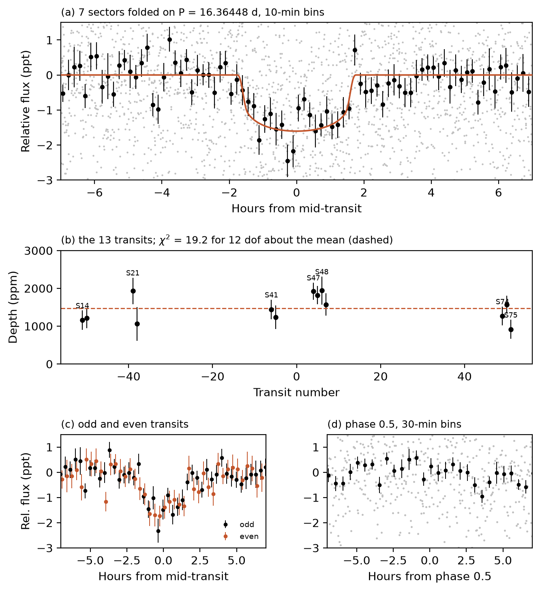

# A 2.7 Earth-radius Planet Candidate on a 16.4-day Orbit around the M Dwarf TIC 149928372

Advait Paliwal
Independent researcher, Sterling Heights, MI 48314, USA
advaitpaliwal@gmail.com

## Abstract

I report a transit-like signal on TIC 149928372, an early M dwarf at 79 pc, found in an ongoing search of 31,405 nearby red dwarfs. TESS photometry from seven sectors spanning 2019–2024 shows 13 transits with a period of 16.36448 d and a depth of about 1,450 ppm. A transit fit gives a radius of 2.67 (+0.29/−0.28) R⊕, an impact parameter of 0.37 and a stellar density matching the catalogue value; the insolation is 8.7 S⊕. Odd and even depths agree, there is no secondary eclipse, the dip is in the raw flux, and difference images place it on the target. With no neighbours removed, TRICERATOPS gives FPP = 0.0169 ± 0.0035 and NFPP = 1.5 × 10⁻⁹; with Gaia companion limits from MOLUSC, FPP = 0.0019. Without high-resolution imaging I make no validation claim. The star is not a TOI.

## Star and search

TIC 149928372 (Stassun et al. 2019; Paegert et al. 2021) has T = 11.40, Teff = 4000 ± 125 K, R★ = 0.66 ± 0.07 R☉ and M★ = 0.62 ± 0.08 M☉, giving a density of 3.04 ± 1.14 g cm⁻³. Gaia DR3 gives G = 12.22, parallax 12.59 mas and RUWE 1.16 (Gaia Collaboration et al. 2023).

I searched TESS (Ricker et al. 2015) light curves of TIC v8.2 dwarfs with Teff = 2700–4000 K, T ≤ 13.5 and distance under 100 pc that no earlier search of mine had covered, after dropping TOI, CTOI and NASA Exoplanet Archive hosts and keeping stars with at least three sectors (31,405 stars). Per sector I used SPOC 2-minute PDCSAP (Jenkins et al. 2016), else TESS-SPOC full-frame-image photometry (Caldwell et al. 2020), else QLP (Huang et al. 2020a, 2020b; Kunimoto et al. 2021); here, SPOC in Sectors 14 and 21 and TESS-SPOC in 41, 47, 48, 74 and 75. Each was flattened with a 0.75 d wotan biweight filter (Hippke et al. 2019) and searched over 1–60 d with the cuvarbase GPU box search (Hoffman 2022) in four passes. The detection threshold, 21.7, is the highest score on flux-inverted light curves of 20 stars, and the pipeline recovered TOI-700 b, c and d. Peaks above threshold with at least three transits went to the flux-level tests of LEO-vetter v1.2.0 (Kunimoto et al. 2025). Of the first 14 stars to pass, this one (score 23.2) is the only new candidate; the other 13 are 4 known signals and 9 false positives, 8 of them eclipsing binaries.

## Transit fit

I fitted 5,930 native-cadence points from 1.2-day windows around the 13 transits, each divided by a quadratic baseline, with batman (Kreidberg 2015) and emcee (Foreman-Mackey et al. 2013): circular orbit, period, mid-time, Rp/R★, b and a/R★ free, no stellar-density prior, and quadratic limb darkening fixed at u₁ = 0.44, u₂ = 0.20 (approximate values for 4000 K), with each cadence supersampled. It gives Rp/R★ = 0.0369 (+0.0017/−0.0012), b = 0.37 (+0.27/−0.25), a/R★ = 36.1 (+2.5/−6.1), duration 3.36 h and T₂₃/T₁₄ = 0.92, a flat-bottomed transit. The fitted density, 3.33 (+0.74/−1.42) g cm⁻³, is 0.3σ from the catalogue value. Including the R★ error, Rp = 2.67 (+0.29/−0.28) R⊕. No posterior sample is grazing and 2.8% have b > 0.8. Fixing b = 0.90 raises χ² by 10.1 and needs a density of 0.39 g cm⁻³; b = 1.0 raises it by 24.7. The ephemeris is P = 16.364477 ± 0.000033 d and T0 = 2459518.8453 ± 0.0012 BJD_TDB. At 0.108 AU the insolation is 8.7 S⊕.

## Vetting

Per-transit box depths give a weighted mean of 1,469 ppm and χ² = 19.2 for 12 degrees of freedom (p = 0.08), none negative. Odd and even depths are 1,381 ± 103 and 1,572 ± 112 ppm (1.25σ). Phase 0.5 gives −133 ± 114 ppm, and the strongest dip on a 91-phase grid is 421 ± 113 ppm (3.7σ, phase 0.54), where the grid scatter is 1.7σ. With a local linear baseline and no detrending, the raw SAP flux gives 1,443 ± 68 ppm against 1,450 ± 74 ppm in PDCSAP across all seven sectors.

In difference images from TESScut cutouts (Brasseur et al. 2019) in all seven sectors, with noise calibrated on 83–111 random-epoch null images per sector, I fitted the TESS PRF (Bell & Higgins 2022) at the target and at the nine Gaia DR3 stars within 150″ brighter than G = 20.5. The target's fitted flux loss is 0.87 ± 0.13 of what the light-curve depth requires. Seven neighbours would need eclipses deeper than 100%. Forcing the signal onto the G = 19.08 star at 29″ (a 61–113% eclipse) is excluded at 2.7–15.5σ per sector, and onto the G = 8.89 giant TIC 149928367 at 83″ (a 0.4–3.5% eclipse) at 8.0–63σ.

The star is not a TOI or CTOI (ExoFOP and NASA Exoplanet Archive lists, 2026 October 24) and is in none of the SPOC 2-minute TCE lists through Sector 105. It was a SPOC full-frame-image TCE in Sector 47 alone (P = 16.3779 d, MES 8.8, two transits). Its data-validation report placed the difference-image centroid 76.1 ± 1.0″ from the target, toward the giant, and ExoMiner++ 2.0 (Valizadegan et al. 2025; Martinho & Valizadegan 2025) scored it 0.037, a false positive. In my Sector 47 difference image the giant's fitted amplitude is 2.4σ against the null images, and the amplitude it would need to produce the dip is excluded at 11.8σ; in the other six sectors its amplitude is −1.1 to +1.0σ.

## False-positive probability

I ran TRICERATOPS v1.1.0 (Giacalone & Dressing 2020; Giacalone et al. 2021) ten times with 10⁶ draws, the pipeline apertures, all 33 field stars, the seven sectors folded into 10-minute bins, and no contrast curve. With no neighbours removed, FPP = 0.0169 ± 0.0035 (0.0100–0.0207 across runs) and NFPP = 1.5 × 10⁻⁹; every nearby-star scenario is zero, and nearly all of the FPP is a planet orbiting an unresolved bound companion. Companion limits came from MOLUSC (Wood et al. 2021), using its Gaia RUWE and contrast tests: it generated 200,000 companions, kept 50.4%, and these replaced TRICERATOPS's default companion prior. Then FPP = 0.0019 ± 0.0017 and NFPP = 1.1 × 10⁻⁹. This is below the 0.015 validation threshold (Giacalone et al. 2021), but I have not checked for high-resolution imaging, so I make no validation claim.

## Summary

TIC 149928372.01 is a 2.7 R⊕ candidate on a 16.4-day orbit around an early M dwarf at 79 pc. High-resolution imaging can test the bound-companion scenario, and ground-based photometry of the 3.4-hour transit can confirm it is on target.

## Acknowledgments

This paper includes data collected by the TESS mission, funded by the NASA Science Mission Directorate, and obtained from MAST. It uses data from the ESA mission Gaia, processed by the Gaia DPAC.

## Figure 1

TESS photometry of TIC 149928372 (SPOC Sectors 14 and 21, TESS-SPOC Sectors 41, 47, 48, 74 and 75). (a) All seven sectors at native cadence folded on P = 16.36448 d (grey), 10-minute bins (black) and the median-parameter model (orange). (b) Depths of the 13 transits with the weighted mean (dashed). (c) Odd (black) and even (orange) transits in 20-minute bins. (d) The flattened light curve at phase 0.5 in 30-minute bins.

## References

Bell, K. J., & Higgins, M. E. 2022, TESS_PRF: Display the TESS pixel response function, ascl:2207.008
Brasseur, C. E., Phillip, C., Fleming, S. W., Mullally, S. E., & White, R. L. 2019, Astrocut: Tools for creating cutouts of TESS images, ascl:1905.007
Caldwell, D. A., Tenenbaum, P., Twicken, J. D., et al. 2020, RNAAS, 4, 201
Foreman-Mackey, D., Hogg, D. W., Lang, D., & Goodman, J. 2013, PASP, 125, 306
Gaia Collaboration, Vallenari, A., Brown, A. G. A., et al. 2023, A&A, 674, A1
Giacalone, S., & Dressing, C. D. 2020, triceratops: Candidate exoplanet rating tool, ascl:2002.004
Giacalone, S., Dressing, C. D., Jensen, E. L. N., et al. 2021, AJ, 161, 24
Hippke, M., David, T. J., Mulders, G. D., & Heller, R. 2019, AJ, 158, 143
Hoffman, J. 2022, cuvarbase: fast period finding utilities for GPUs, ascl:2210.030
Huang, C. X., Vanderburg, A., Pál, A., et al. 2020a, RNAAS, 4, 204
Huang, C. X., Vanderburg, A., Pál, A., et al. 2020b, RNAAS, 4, 206
Jenkins, J. M., Twicken, J. D., McCauliff, S., et al. 2016, Proc. SPIE, 9913, 99133E
Kreidberg, L. 2015, PASP, 127, 1161
Kunimoto, M., Bryson, S., Jaffee, D., et al. 2025, AJ, 170, 280
Kunimoto, M., Huang, C., Tey, E., et al. 2021, RNAAS, 5, 234
Martinho, M., & Valizadegan, H. 2025, ExoMiner++ 2.0: Vetting TESS Full-Frame Image Transit Signals, Zenodo, doi:10.5281/zenodo.17707413
Paegert, M., Stassun, K. G., Collins, K. A., et al. 2021, arXiv:2108.04778
Ricker, G. R., Winn, J. N., Vanderspek, R., et al. 2015, JATIS, 1, 014003
Stassun, K. G., Oelkers, R. J., Paegert, M., et al. 2019, AJ, 158, 138
Valizadegan, H., Martinho, M. J. S., Jenkins, J. M., et al. 2025, AJ, 170, 287
Wood, M. L., Mann, A. W., & Kraus, A. L. 2021, AJ, 162, 128
